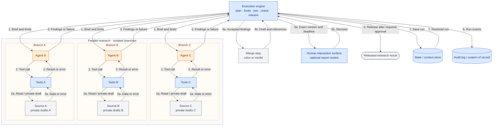
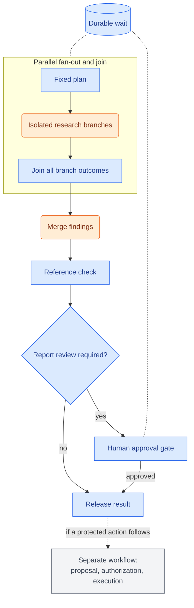
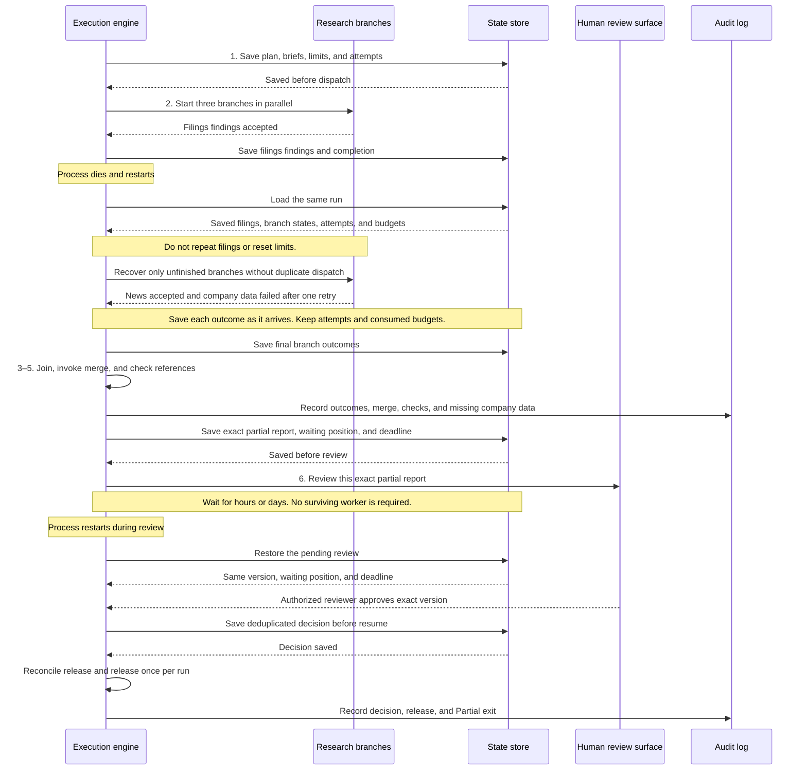

# Parallel Research and Merge

**The job it serves:** Answer one business task with findings from independent sources. Agents research in parallel. The workflow combines the findings into one result with references to their origin \
**Built from patterns:** [Parallel fan-out and join](../patterns/parallel-fan-out-and-join.md) · [Branch isolation](../patterns/branch-isolation.md) · [Durable wait](../patterns/durable-wait.md) · [Human approval gate](../patterns/human-approval-gate.md) · [Proposal/execution split](../patterns/proposal-execution-split.md) \
**Requires capabilities:** Execution engine · research agents · tool access layer · merge step · state/context store · audit log · human interaction surface (if a person approves) \
**Audience:** People who build or examine workflows that divide research between agents

## Status

Draft for working group review. The 13 decisions in the appendix are fixed for this draft, not approved WG guidance.

## Purpose

Use this architecture when one request needs research from several independent sources, such as filings, news, and company data. Each agent receives instructions for one source and works independently, like an analyst assigned one part of a report. A plan fixed before work starts sets the limits and identifies which sources are essential. The workflow collects the findings and combines them into one result. Each claim refers to saved findings, so readers can trace its recorded origin. Disagreements stay visible, and missing sources are named. Rules set in advance decide whether a gap permits a partial result or requires the run to stop.

> **Terminology:** Core terms follow the [workflow taxonomy](../../taxonomy/terms.md). 
> - **branch** is one research part; **brief** gives it instructions and initial context. 
> - **join** collects branch outcomes; **merge step** combines findings. 
> - **accepted result** has the required format, not verified content.
> - **finding reference** points to a saved finding in this run; the **reference check** checks those links and branch labels, not claim truth.

## Is this your architecture? (checklist)

All answers are yes: use this architecture; any answer is no: follow the route in the table.

| # | Question | If no, use instead |
|---|---|---|
| 1 | Can the research parts run without each other's results? | Run the steps in order. Use one agent for reasoning and code for fixed rules. No general sequential RA is defined here |
| 2 | Does each part examine different material? | Use one research agent, or code if model reasoning is not needed |
| 3 | Is it known which sources are essential and which may be missing? | First decide which sources are required and whether a partial answer is acceptable |
| 4 | Can the research parts work without communication between them? | This job needs agents that communicate. No matching RA is defined here yet |
| 5 | Is the result only for reading, with any protected action handled separately? | Use [Human Approval](single-agent-human-approval.md) for human-authorized actions, or [Bounded Remediation](bounded-autonomous-remediation.md) for limited repair tasks. Other policy-authorized actions have no RA here yet |

## Variants

None. Agent-to-agent communication, independent checking, and fleet-wide remediation are different jobs. A plan chosen or changed by agents during the run is also outside this architecture.

## Structure

This diagram shows the execution engine above the capabilities it coordinates. Read the numbered exchanges below it from left to right. Each parallel branch shows its agent, tools, and source from top to bottom, with separate context and permissions. The agent's internal reasoning is not specified.

> **Legend:** blue = workflow control; orange = research agents; gray = sources, output, or a merge using rules or a model. Each arrow shows one direction of data exchange. Exchanges 1–6 follow the main path; 7–8 apply throughout, not after release. Report approval does not authorize a later protected action.

| Capability | Exchanges | Responsibility | Charter basis |
|---|---|---|---|
| Execution engine | 1, 3–8 | Sends briefs (1); joins branch outcomes (3); invokes merge (4); checks labels and references before review (5) or release (6). Owns limits, retries, review decisions, saved state (7), and audit records (8) | 3A, 3B |
| Research agents | 1, 2, 3 | Receive separate briefs (1), research through their own tools (2), and return findings or failure (3) | 3A, 3C |
| Tool access layer | 2, 2a | Receives each agent's calls (2), permits assigned-source reads and private drafts (2a), and returns results. No protected-effect tools | 3C |
| Merge step | 4a, 4b | Receives saved accepted findings and all branch states after the join (4a); returns a draft with branch labels and finding references (4b) | 3A |
| State/context store | 7, throughout | Saves and restores the plan, findings, attempts, budgets, and waiting position. Completed branch results are saved as they finish | 3B |
| Audit log | 8, throughout | Records branch outcomes, checks, decisions, and release under one run id | 3B |
| Human interaction surface | 5a, 5b, if review is required | Shows the exact checked version and deadline (5a); returns the identified, authorized reviewer's decision (5b). The engine saves it before release | 3D |

These are roles, not separate required services. Codes refer to [charter scope 3A–3F](../../../charter/charter.md#3-scope).

## Pattern composition

Two patterns control parallel work. Durable wait preserves progress. The approval patterns apply only when needed.

| Pattern | Where it sits | Why it is required here |
|---|---|---|
| [Parallel fan-out and join](../patterns/parallel-fan-out-and-join.md) | Plan through join | Fixes branches and failure rules; bounds waiting and identifies missing results |
| [Branch isolation](../patterns/branch-isolation.md) | Around each branch | Prevents direct cross-branch access and protected effects |
| [Durable wait](../patterns/durable-wait.md) | Branch waits and any human gate | Keeps position, context, identity, and deadlines across restart |
| [Human approval gate](../patterns/human-approval-gate.md), if review is required | After the reference check | Binds an explicit decision to the exact result, complete or partial |
| [Proposal/execution split](../patterns/proposal-execution-split.md), if an action follows | In the separate action workflow | Keeps the report as data; that workflow authorizes and performs the action |

**Invalid compositions:** protected-effect tools in a branch; cross-branch messages or notes; an unlimited wait; a hidden missing branch; a plan changed during the run.

## The agent and workflow-control boundary

Research agents read their source, write private drafts, and return findings or failure.  
A merge agent combines the supplied findings.  
No agent can cause a protected effect.  
The engine owns the plan, limits, attempts, saved state, checks, review, release, and records. 

The engine saves accepted findings with stable run, branch, and finding identifiers.  
Each claim must have a finding reference and labels for its referenced branches.  
For example: branch `News`, finding `News-17`.

The reference check verifies that every reference points to an accepted finding in this run and matches its branch label.  
It removes claims with missing or invalid references or labels and records each removal.  
It does not prove that the finding supports the claim, or that either is true.

## Choosing deterministic and model-driven activities

Use rules for plans, limits, retries, joins, format and reference checks, review handling, and records.  
These activities need consistent, testable behavior.  
Cost alone is not the reason.

Use model reasoning for open-ended research.  
Use model for the merge only when combining findings needs judgment.  
A model never chooses the branch count, split, or next activity.

## Exit states

Result coverage is complete or partial before release. The final states below also say how the run ended. A person can reject either result. Pending review is not an exit.

| Exit state | Reached when | Recorded as |
|---|---|---|
| Completed | All branches have accepted results, and the checked result is released after any required approval | Plan, branch results, merge, check, decision if any, release |
| Partial | All required branches have accepted results; an optional result is missing; the checked result is released with the gap stated, after any required approval | The same records, plus missing branches and reasons |
| Failed | A required branch fails after one retry; the run reaches its limit; or planning, storage, merge, check, or release cannot finish within those limits | Failed activity, reason, branch states, attempts, budget, saved state |
| Rejected | A reviewer explicitly rejects the result | Reviewer identity, time, exact version, decision |
| Expired | The review deadline passes without a decision or continuing escalation | Deadline and escalation history |
| Escalated | Responsibility moves to a person or another workflow instead of releasing the result | Target, reason, and saved state |
| Cancelled | An authorized requester or operator stops the run before release | Who, why, and saved state |

## Worked scenario: a market landscape report

A strategy team needs a report. The [inventory](../../critical-use-cases/use-case-inventory.md#research--intel) identifies the risk of outdated market data. It also includes critique before writing, which is outside this example. The plan, failure, and recovery below illustrate the architecture, not a verified deployment.

1. **Plan** *(engine, state store).* Filings and news are required. Company data is optional. The engine saves the briefs, limits, and one-retry default before dispatch.
2. **Research** *(agents, tool access layer, state store).* Three read-only branches work in parallel. Each accepted finding has a source, retrieval date, and stable identifier. The engine saves results before marking branches done.
3. **Join** *(engine).* Company data fails twice. All branches now have a final status. The plan permits a partial result because only an optional branch is missing.
4. **Merge** *(merge agent).* Each claim gets branch labels and finding references. Two conflicting market-size estimates appear side by side.
5. **Check** *(engine).* Invalid references or missing labels cause claim removal, recorded in the audit log. A banner says "Partial: company data missing."
6. **Approve and release** *(person, engine, audit log).* An identified, authorized analyst approves that exact version. The engine saves the decision before release. The release is recorded once per run. Any later protected action belongs to another workflow.

### The run over time: where durability lives

Read from top to bottom. This example shows approval of a partial report after two process restarts. The branch column groups separate agents that research in parallel. Other exits remain in Exit states and the recovery table.

### If the process dies during activity N

Recovery keeps the same plan, retry count, and consumed budget. Repeated reads can cost money or see newer data.

| Activity | Recovery | Required control |
|---|---|---|
| 1. Plan and dispatch | Reload the plan; reconcile which branches started | Stable request/branch ids and dispatch deduplication |
| 2. Research | Keep saved results; recover only unfinished branches | Durable results, attempt records, and unchanged budgets |
| 3. Join | Reapply the saved rule to branch states | Saved outcomes, deadlines, and retry count |
| 4. Merge | Use a saved completed draft or rerun from saved findings | Stable finding identifiers; no protected effect |
| 5. Check | Reapply the rule to the saved draft | Same finding set and version-linked removal records |
| 6. Review and release | Restore the exact review version and deadline; reconcile release before retry | Record decision before resume; deduplicate decisions and release |

## Composition considerations

- **Sensitivity:** protect the merged result as carefully as the most sensitive branch.
- **References:** a checked reference proves a link exists, not that the finding supports the claim.
- **Hostile content:** isolation does not stop hostile findings reaching the merge. They remain untrusted input; the merge has no protected-effect tools.
- **Approval:** approve the exact version, including any missing-source banner. Edits need new approval. Report approval does not authorize a later action.
- **Total limits:** branch limits do not cover the whole run. Include retries and merge in the run budget.
- **Late results:** record and ignore them after the join. Never change a released result silently.

## Out of scope (handled elsewhere)

- Independent checking, agent-chosen routing, and coordination across teams or companies: different jobs.
- Fleet-wide remediation: effectful branches need their own composition; see [Bounded autonomous remediation](bounded-autonomous-remediation.md).
- Credential issuance and delegation: Identity & Trust WG.
- Hostile-content and data-exfiltration defenses: Security WG.
- Finding quality: Accuracy & Reliability WG.
- Traces, metrics, and telemetry: Observability WG. The audit log here is a system of record.

## Validation record

These are initial fit assessments from the [inventory](../../critical-use-cases/use-case-inventory.md) and its [schema](../../critical-use-cases/schema-agentic-use-cases.md), not tested implementations. The Use Cases workstream should confirm them. `Validated` means architectural fit under the [validation guide](../docs/ra-use-case-validation-guide.md). `Partial fit` describes limited coverage here, not the guide's formal `Partial` result.

| Scenario | Source | Result | Notes |
|---|---|---|---|
| Supplier bid evaluation | [Supply chain](../../critical-use-cases/use-case-inventory.md#supply-chain) | Validated | Independent bids are scored concurrently and merged, with approval. The inventory calls this the natural design; pre-run branch count is not established |
| Architecture decision record (ADR) drafting | [SDLC](../../critical-use-cases/use-case-inventory.md#sdlc) | Validated | Parallel earlier-record retrieval and options generation feed a writer and team review. Options generation does not necessarily use a separate source |
| Bug triage from logs | [Engineering](../../critical-use-cases/use-case-inventory.md#engineering) | Candidate | Parallel log/code research feeds synthesis. Who writes the Jira ticket, and whether writing is separate from research, are unknown |
| Cross-brand product recommendation | [Marketing](../../critical-use-cases/use-case-inventory.md#marketing) | Validated | Separate catalogs feed synthesis and ranking, with fixed coordination. No mandatory human gate; restart behavior is not described |
| Market landscape report | [Research & intel](../../critical-use-cases/use-case-inventory.md#research--intel) | Partial fit | Research and synthesis fit. Additional critique before writing is not covered; its independence is not established |
| Case law research brief | [Legal](../../critical-use-cases/use-case-inventory.md#legal) | Partial fit | Parallel search and synthesis fit. Additional citation checking and sign-off are present; checking independence is not established |
| Content repurposing pipeline | [Marketing](../../critical-use-cases/use-case-inventory.md#marketing) | Partial fit | Only the parallel pattern fits. Producing formats from one blog post is not independent-source research |
| Closed-loop dependency & CVE remediation (fleet-wide) | [SDLC](../../critical-use-cases/use-case-inventory.md#sdlc) | No fit | Branches write and test fixes and open PRs; they are not read-only research |
| Service deployment orchestration | [Platform engineering](../../critical-use-cases/use-case-inventory.md#platform-engineering) | No fit | Monitoring can abort effectful deployment; the inventory also records runtime AI routing |

## Open questions

None.

## Appendix: Design decisions

### Decisions taken, and why

These fixed choices remain. Finding references add a check to the existing branch-label rule.

| Decision | Why |
|---|---|
| The execution engine runs a fixed plan. Agents never decide who runs next | Limits need workflow control. The inventory has 44 multi-agent rows: 38 Fixed/scripted, 2 AI-coordinated, routing, and 4 unspecified. These labels do not prove this fixed-plan design |
| The plan is built by rules from a template for the type of task, before work starts. A model does not choose the number or kind of branches | Makes runs predictable and auditable |
| No branch can start more branches | Bounds work and cost |
| Branches cannot see each other's work until the join | Keeps direct cross-branch influence out of research |
| Branches are read-only | Research cannot cause a protected effect |
| Each branch is required or optional, set in the plan | Failure handling is decided before the run |
| One retry per failed branch, then the plan's rule applies | A design default within saved limits, not evidence that one retry is optimal |
| A result built from fewer branches than planned is always marked partial | Makes missing work visible |
| Disagreements between branches are shown side by side, never resolved silently | Lets the reader see the disagreement |
| Every claim carries the label of its branch. Unlabeled claims are removed | Finding references also identify saved evidence. Neither check proves truth |
| The join and the merge are separate steps | Collection uses rules; combining findings may need judgment |
| The checklist tests whether the parts are independent, not how big the job is | Model capacity changes; independence is a stable routing test |
| A result that arrives after the join is ignored and recorded | Keeps reviewed and released content unchanged |
