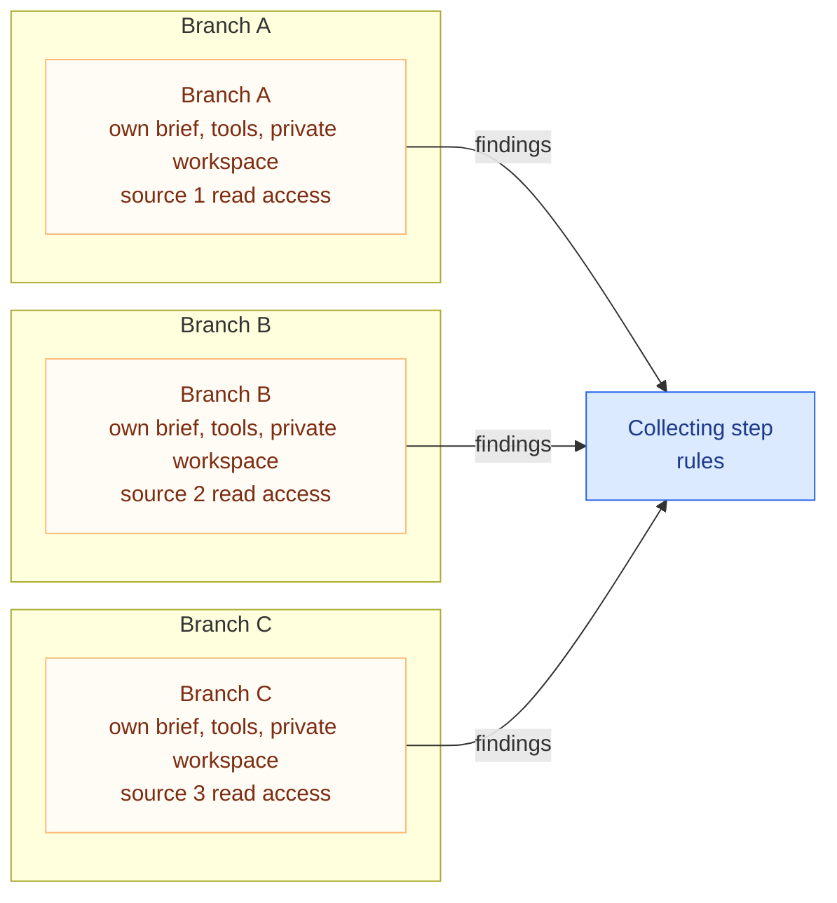

# Branch Isolation

**Solves:** Keeping parallel branches independent, so no branch can read another's work, message another, or cause a protected effect \
**Used in:** [Parallel research and merge](../architectures/parallel-research-and-merge.md) \
**Requires capabilities:** Execution engine · tool access layer · audit log \
**Related patterns:** [Parallel fan-out and join](parallel-fan-out-and-join.md) · [Proposal/execution split](proposal-execution-split.md)

> **Terminology:** Core terms follow the [workflow taxonomy](../../taxonomy/terms.md). A **brief** is the instructions and initial context the execution engine gives one branch. *Brief* is not yet a taxonomy term.

## Problem

Parallel agents often share a workspace, conversation, or credential. Shared access lets one branch influence another directly. Several independent views can become one repeated view.

## Why this is hard

- Sharing is easy, and many systems share by default.
- Restrictions must remain effective when an agent follows hostile instructions.
- A branch needs enough context to work without access to other branches' material.
- Findings leave the branch, pass through the workflow's collecting step, and reach whatever consumes them. Hostile source content can travel that path; branch isolation does not stop it.

## Solution

Give each branch its own brief, tools, credentials, and private workspace. The brief contains the engine's initial context for that branch. Branches do not share notes, credentials, or communication channels. Findings leave through the workflow's collecting step, after the branch ends.

The branches can share controlled infrastructure. They cannot share working context or access each other's material. The collecting step receives the findings after each branch ends, and whatever consumes them treats them as untrusted input without protected-effect tools. How collection and combining split is a decision for the composition that uses this pattern.

## Invariants (must hold in any implementation)

- The engine writes each branch's brief. This is its only initial context; the branch then reads its permitted source.
- A branch cannot read another branch's work or message it. Branch findings leave through the workflow's collecting step, after the branch ends.
- Tools permit reading the assigned source and writing private drafts. They cannot send, pay, or change a protected target.
- Credentials permit only the source reads and private draft storage needed by that branch.
- Permissions, tool availability, and communication restrictions enforce these rules. Instructions alone do not.
- Remove scratch workspaces when branches finish. Keep returned findings and required workflow/audit records, not scratch leftovers for another run.
- Record operations under one run id and a separate branch id.

## Failure modes when violated

- **Another branch controls the brief:** one branch can steer another before its work starts.
- **Shared notes or messages:** an error or hostile instruction can influence other branches directly.
- **Protected-effect tool:** a branch can send, pay, or change a target without authorization.
- **Credentials too broad:** a steered branch reaches systems outside its task.
- **Prompt-only restriction:** the agent can follow an instruction that breaks the supposed boundary.
- **Workspace reused:** old content leaks into another run.
- **Branch id absent:** a reviewer cannot identify which branch performed an operation.

## Implementation approaches (illustrative, not requirements)

Implementations differ in **where isolation is enforced**. Combine layers as needed. Each row supplies only part of the pattern; identity or resource separation alone is not full isolation.

| Enforced at | Documented mechanism | What it provides | What the implementation must add |
|---|---|---|---|
| Identity | [AWS IAM roles](https://docs.aws.amazon.com/IAM/latest/UserGuide/id_roles.html) | Permission sets and temporary session credentials | The engine assigns a read-only, source-scoped role per branch. Restrict trust and permission policies to prevent other-role access or broader credentials. Separate files and communication remain necessary |
| Workload identity | [Kubernetes service accounts](https://kubernetes.io/docs/concepts/security/service-accounts/) | A Pod uses its assigned account; several Pods can share one. Role-based access control (RBAC) limits Kubernetes API access | A dedicated account per branch and suitable source authorization. Add [enforced network/storage boundaries](https://kubernetes.io/docs/concepts/security/multi-tenancy/), private scratch cleanup, and no other branch's secrets. Disable unused API-token mounts. RBAC alone does not isolate the workload |
| Resources | [Bulkhead pattern (Azure)](https://learn.microsoft.com/en-us/azure/architecture/patterns/bulkhead) | Separate resource pools limit cascading failures | Size limits per branch and account for shared dependencies. Permissions and communication controls must restrict access; resource limits alone do not |

## Known uses outside agents

Service identities and least privilege limit access. Bulkheads separate resources to limit cascading failures. These controls address different risks; no single control gives every branch boundary.

An agent's instructions are not an access boundary. Enforce restrictions outside the agent. Isolation does not prove that findings are safe or true. Defenses for hostile source content belong to the Security workstream.
