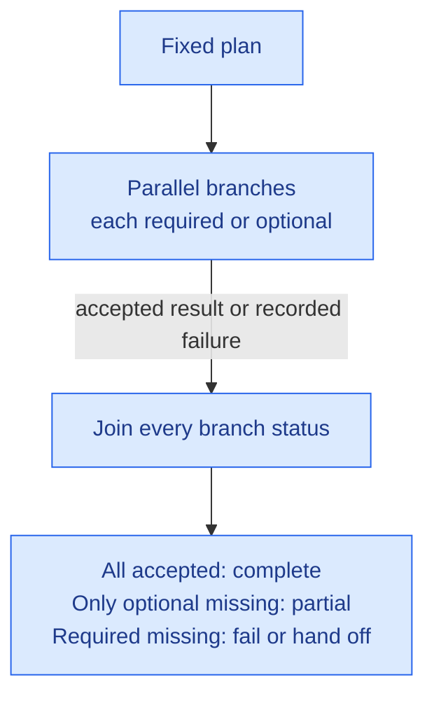

# Parallel Fan-out and Join

**Solves:** Running independent parts of a task at the same time under a bounded wait, so failed or missing parts stay visible \
**Used in:** [Parallel research and merge](../architectures/parallel-research-and-merge.md) \
**Requires capabilities:** Execution engine · state/context store \
**Related patterns:** [Branch isolation](branch-isolation.md) · [Durable wait](durable-wait.md)

## Problem

Independent parts can run at the same time. The workflow must decide how long to wait and what a failed part means. It must also show which parts have no accepted result.

## Why this is hard

- Waiting for all parts can last forever. Taking only the first replies can hide missing work.
- Parts finish at different times. Restart must not lose or repeat saved work.
- An unmarked partial result can look complete.
- Different result formats make collection unreliable. Adding branches during a run can increase cost without limit.

## Solution

Fix the branches before work starts. Run them in parallel, then join their final outcomes. Collection is separate from any later interpretation of the results.

A branch can be an agent or a conventional task, such as a database query. The parent workflow decides what follows the join. Complete or partial coverage does not mean the whole workflow has finished.

## Invariants (must hold in any implementation)

- The plan fixes branches, their work, and required-or-optional status before the first branch starts. Branches cannot add work or change the plan.
- Each branch and the whole run have time and cost limits. Attempts and restarts cannot reset these limits.
- The plan limits attempts. The join waits until every planned branch is done, failed, or explicitly skipped. A limit or invalid result format counts as failure.
- The joined output names every branch and its final status.
- An accepted result has the required format. Acceptance does not prove truth.
- Complete coverage requires accepted results from all planned branches. Missing optional results give partial coverage, which is marked. A failed or skipped required branch causes failure or an explicit handoff, never partial success.
- Save each accepted result durably before marking the branch done. Keep its run id, branch id, and attempt. Saved results are not repeated after restart.
- Accept at most one result per branch. Record and ignore duplicate results, results from ended attempts, and results arriving after the join.

## Failure modes when violated

- **Plan changes:** added work increases cost beyond the agreed scope.
- **Limits absent or reset:** a source that does not respond, or repeated restarts, keeps consuming resources.
- **Join too early:** important slow replies are missing before their deadline.
- **Branch status or partial marker missing:** a reader treats an incomplete result as complete.
- **Required failure allowed through:** essential input is missing, but the run still proceeds as a success.
- **Result not saved before done:** restart loses completed work. Duplicate results can count one finding twice.
- **Wrong format accepted:** collection misreads or drops results.
- **Late result merged:** released or approved content no longer matches its record.

## Implementation approaches (illustrative, not requirements)

Implementations differ in **where parallel execution and the join rule are enforced**. Each row contributes controls, not the whole pattern. All invariants still apply.

| Enforced at | Documented mechanism | What it provides | What the implementation must add |
|---|---|---|---|
| Orchestration service | [AWS Step Functions Parallel state](https://docs.aws.amazon.com/step-functions/latest/dg/state-parallel.html) | Runs branches as concurrently as possible and waits for all. An unhandled branch error fails the state | Required/optional handling, limits, format checks, partial markers, and late-result records. Put retries inside branches. Use durable state; [Standard persists state, Express does not](https://docs.aws.amazon.com/step-functions/latest/dg/choosing-workflow-type.html). Stopping a branch does not stop running Lambda functions; activity workers need cooperative stopping |
| Integration layer | [Spring Integration scatter-gather](https://docs.spring.io/spring-integration/reference/scatter-gather.html) | Routes requests and collects correlated replies. A configured gather timeout bounds waiting for the aggregate reply, not synchronous recipient execution | Async recipient execution, branch/run limits, failure replies, and a fixed release rule. Timeout alone does not produce a partial result. Save branch/reply state and completion records; saved replies alone do not provide restart-safe dispatch |
| Agent framework | [LangGraph Graph API](https://docs.langchain.com/oss/python/langgraph/graph-api) | Runs parallel nodes and combines state updates. Static edges support fixed branches | An explicit join, required/optional failure handling, limits, format checks, and partial markers. Reducers alone are not the join. Configure [persistent, crash-safe checkpoints](https://docs.langchain.com/oss/python/langgraph/checkpointers); memory-only storage cannot survive restart. Per-attempt timeouts do not replace branch/run budgets |

## Known uses outside agents

[Scatter-Gather](https://www.enterpriseintegrationpatterns.com/patterns/messaging/BroadcastAggregate.html) collects replies from several recipients. Its loan-broker example asks banks for quotes and selects an offer. This supports the basic structure, not every failure or recovery rule here.

Agent results can be wrong even when a branch finishes successfully. This pattern preserves the origin of each branch result, separately from the join's record of missing branches. Linking a claim to the finding behind it belongs to the composition that merges the results. Neither record proves content quality.
